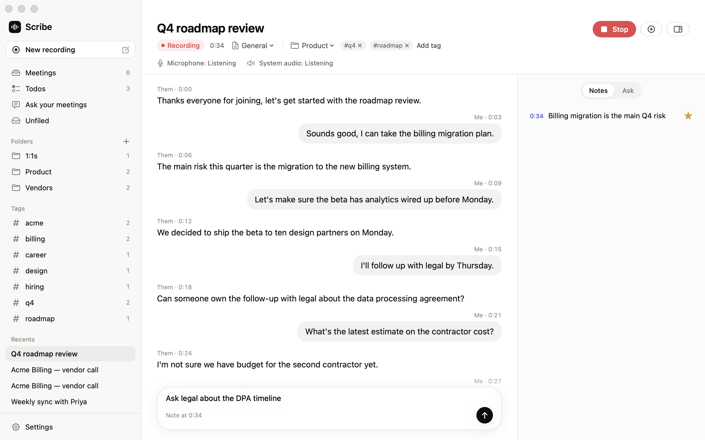
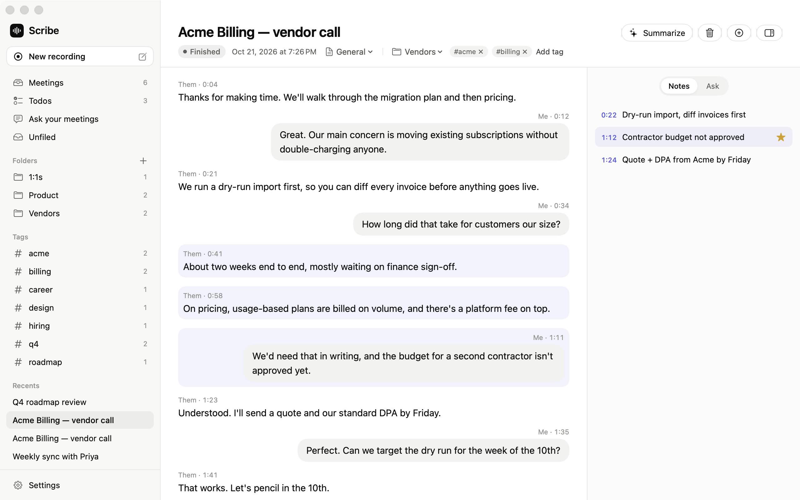
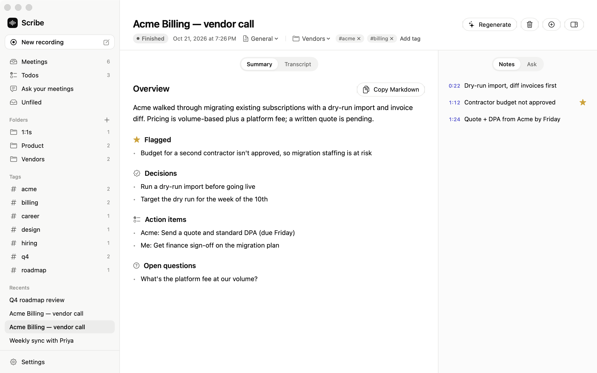
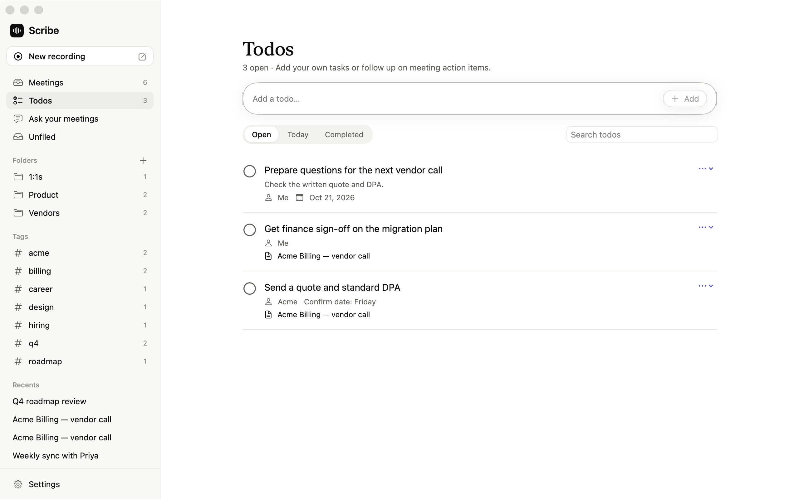
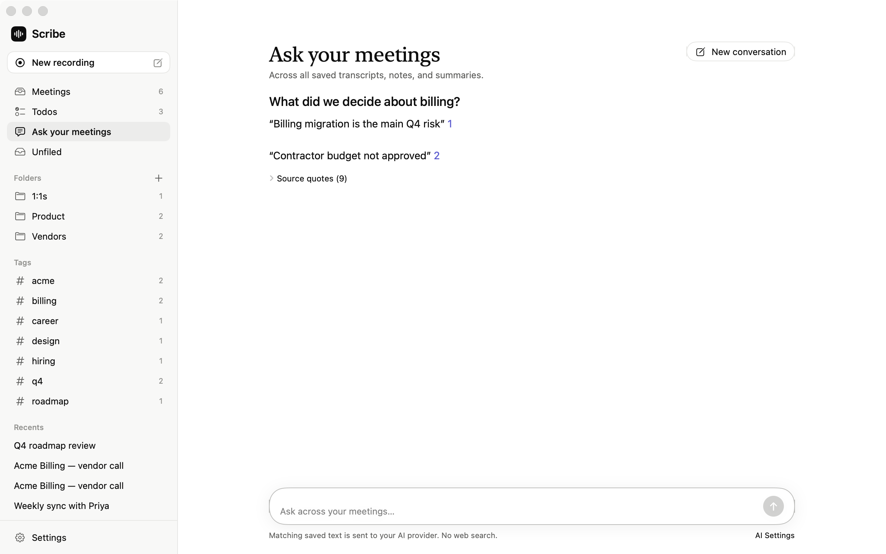
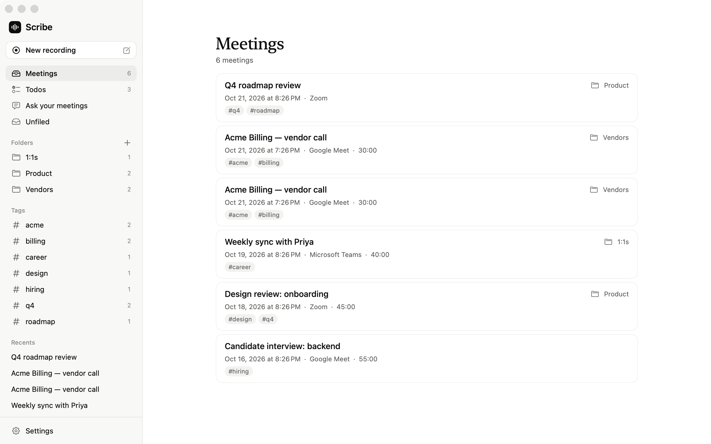

# Scribe

Meeting notes for macOS. Live transcripts, summaries, and todos, without a bot joining your call.

<picture>
  <source media="(prefers-color-scheme: dark)" srcset="docs/screenshots/1-live-meeting-dark.png">
  
</picture>

- Transcribe both sides on your Mac with Apple SpeechAnalyzer, WhisperKit, or Cohere Transcribe.
- Take timestamped notes and get a summary with decisions and action items.
- Get an AI-generated title when recording ends, or edit the title and choose **Save**.
- Manage meeting follow-ups and personal tasks in Todos.
- Ask questions across saved meetings with citations.
- Organize calls with folders and tags.
- Connect multiple Google accounts, choose calendars, and start recordings from upcoming events.

<details>
<summary>More screenshots</summary>

### Notes

<picture>
  <source media="(prefers-color-scheme: dark)" srcset="docs/screenshots/3-note-highlight-dark.png">
  
</picture>

### Summaries

<picture>
  <source media="(prefers-color-scheme: dark)" srcset="docs/screenshots/2-summary-dark.png">
  
</picture>

### Todos

<picture>
  <source media="(prefers-color-scheme: dark)" srcset="docs/screenshots/7-todos-dark.png">
  
</picture>

### Ask your meetings

<picture>
  <source media="(prefers-color-scheme: dark)" srcset="docs/screenshots/6-ask-meetings-dark.png">
  
</picture>

### Library

<picture>
  <source media="(prefers-color-scheme: dark)" srcset="docs/screenshots/5-library-dark.png">
  
</picture>

Screenshots use demo data.

</details>

## Get started

Alpha software. Requires macOS 14.2+. SpeechAnalyzer needs macOS 26. Cohere needs Apple Silicon, Swift 6.3+, and Xcode's Metal toolchain.

```sh
xcodegen generate
open Scribe.xcodeproj
```

Build and run in Xcode. In Settings, choose a transcriber and configure an AI provider for Q&A and summaries. Allow microphone and system audio access, then start **New recording**.

## Privacy

Meeting text and todos stay in a local SQLite database. New meetings do not save audio. Q&A, summaries, and automatic titles send text to your selected AI provider. Get any required consent before capturing a call.

[Setup, development, and release guide](docs/guide.md) · [MIT License](LICENSE) · [Third-party notices](THIRD_PARTY_NOTICES.md)
